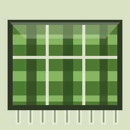
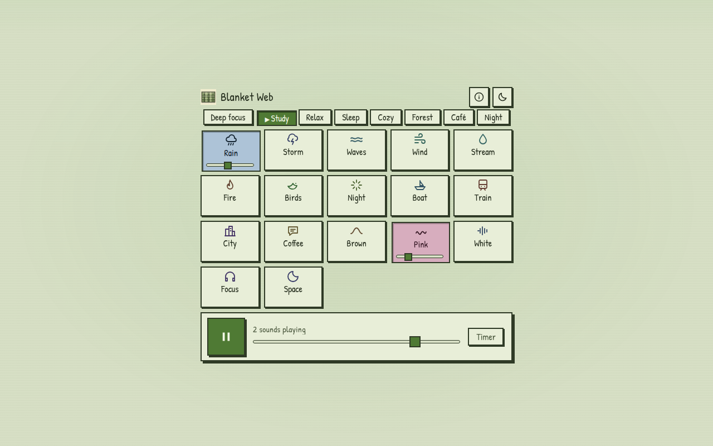
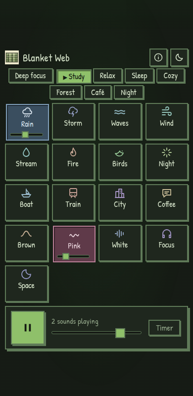

<p align="center">
  
</p>

<h1 align="center">Blanket Web</h1>

<p align="center">
  <b>Free focus, study &amp; relaxation sounds in your browser.</b><br>
  Mix rain, ocean, fire, wind and white / pink / brown noise. No ads, no tracking, works offline.
</p>

<p align="center">
  <a href="https://mkalmousli.github.io/NoiseSpace/"><b>▶ Open the app</b></a>
</p>

<p align="center">
  
  
</p>

## Features

- **17 sounds**: 12 real recordings (rain, storm, waves, wind, stream, fire, birds, summer night, boat,
  train, city, coffee shop; the set used by [Blanket](https://github.com/rafaelmardojai/blanket), credited below and on the site) plus
  white / pink / brown noise, a 10 Hz binaural focus tone and a space drone synthesized live with the
  Web Audio API. Recordings load on first use (about 300 KB each) and are cached for offline use;
  if one cannot load, a synthesized physical model of that sound plays instead.
  See the [FAQ](https://mkalmousli.github.io/NoiseSpace/#faq) for the science and references.
- **Layer and mix** any sounds with per-sound volume and a master fader.
- **Presets**: Deep focus, Study, Relax, Sleep, Cozy, Forest, Night.
- **Sleep timer** with a gentle fade-out.
- **Light and dark** themes (follows your system, remembers your choice).
- **Frutiger Aero** glass UI, calm colors, responsive from phones to desktops.
- **Installable and offline** (PWA + service worker), settings saved locally.

## Under the hood

Pure HTML, CSS and ES5 JavaScript. No build step, no dependencies, and every file stays
under 100 lines.

| File | Role |
| --- | --- |
| `index.html` | Markup, SEO metadata, JSON-LD |
| `css/base.css` · `layout.css` · `aero.css` | Tokens and backdrop · structure · glass components |
| `js/noise.js` · `drops.js` · `waves.js` | Noise colors · rain/stream/fire models · ocean/crickets |
| `js/voices.js` | Formant-synthesized talker babble |
| `js/helpers.js` · `engine.js` | Builder helpers · audio engine |
| `js/sounds-nature.js` · `sounds-tone.js` · `catalog.js` | Sound graphs · tones · catalog and presets |
| `js/store.js` · `icons.js` · `ui.js` · `app.js` | Settings · icons · rendering · wiring |
| `sw.js` · `manifest.json` | Offline cache and PWA manifest |

## Run locally

```sh
python3 -m http.server 8000   # then open http://localhost:8000
```

## Deploy

Pushing to `main` publishes the site to GitHub Pages through `.github/workflows/pages.yml`.

## License

MIT

By [al-mo.de](https://al-mo.de). MIT licensed.

Font: [Patrick Hand](https://fonts.google.com/specimen/Patrick+Hand) (SIL OFL), self-hosted.

## Sound credits

Same sources and licences as [Blanket's list](https://github.com/rafaelmardojai/blanket/blob/master/SOUNDS_LICENSING.md):
Rain: alex36917 (CC BY) · Storm: Digifish music (CC BY) · Waves: Luftrum (CC BY) · Wind: felix.blume (CC0) ·
Stream: gluckose (CC0) · Fire: ezwa, SoundBible (PD) · Birds: kvgarlic (CC0) · Night: Lisa Redfern, SoundBible (PD) ·
Boat: Falcet (CC0) · Train: SDLx (CC BY 3.0) · City: gezortenplotz (CC BY) · Coffee: stephan, SoundBible (PD).
Trimmed, mono, loudness-matched and cross-faded into loops.
